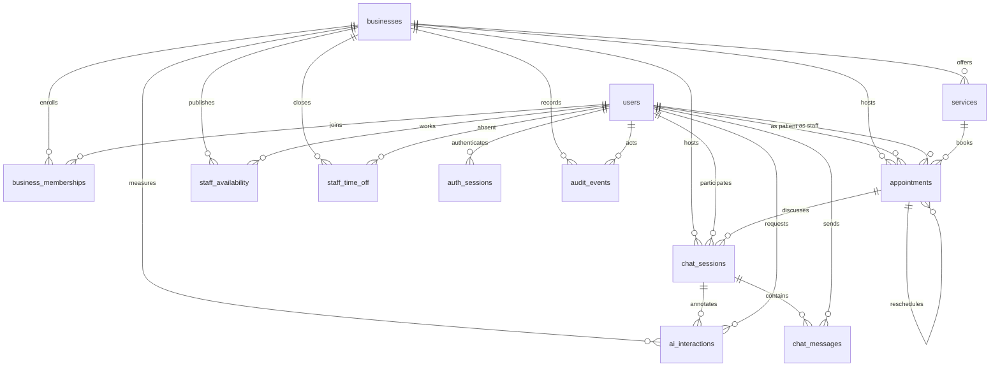

# Database

PostgreSQL is the system of record. Prisma Migrate applies versioned migrations for the API. `database/schema.sql` is the same end state in one script so the shape can be reviewed without generating a client. `database/seed.sql` loads fictional demo data.

Apply the migrations to an empty database with Prisma. Do not also run `database/schema.sql` on that database. The SQL file is for review, or for loading a blank database outside Prisma. Running both creates the same tables twice.

```powershell
npm run db:up
npm run db:deploy
npm run db:seed
```

`db:deploy` applies the committed migrations without a prompt. `db:migrate` runs `prisma migrate dev` while the schema is changing. `db:down` stops the container and keeps the volume. The API reads `DATABASE_URL` from `apps/api/.env`. Prisma CLI commands load that file through `apps/api/prisma7.config.ts`.

`docker-compose.yml` starts PostgreSQL 16 with the user, password, and database name `careflow`. Those values are local defaults, not production credentials.

## Model

A person has one `users` row. A clinic is a `businesses` row. `business_memberships` gives that person one role at one clinic: `owner`, `staff`, or `patient`. The same email can be staff at one clinic and a patient at another because the role lives on the membership, not on the user.



`users`, `appointments`, and `chat_sessions` are the account, booking, and conversation tables. `schema_meta` stores the seed version. `applied_at` and every other timestamp column use `timestamptz`.

## Tenant boundaries

Composite foreign keys reject a row that mixes two clinics:

| Child                                  | Must match the clinic on                                                                                                              |
| -------------------------------------- | ------------------------------------------------------------------------------------------------------------------------------------- |
| `appointments`                         | patient membership with role `patient`, staff membership when staff is assigned, service, and the appointment it was rescheduled from |
| `staff_availability`, `staff_time_off` | staff membership whose role is `owner` or `staff`                                                                                     |
| `chat_sessions`                        | participant membership, and the appointment when one is linked                                                                        |
| `chat_messages`                        | the session, and the sender's membership when the sender is a user                                                                    |
| `ai_interactions`                      | the chat session when one is linked                                                                                                   |

A nullable pair uses `MATCH SIMPLE`. The foreign key is enforced when the optional id is present. Checks require `staff_user_id` and `staff_role` to be both null or both set, and they require a user sender for `sender_kind = 'user'`.

Appointment overlap is different from tenant scope. `appointments_no_active_staff_overlap` is per staff user, across clinics. One person cannot hold two active bookings at the same time even if the clinics differ. Availability and time off stay per clinic because those rules are local schedules, not a claim that the person is in two rooms.

Queries still need an explicit `business_id` filter. The foreign keys stop cross-clinic writes. They do not hide other clinics' rows from a query that forgets the filter.

## Appointment lifecycle

`appointment_status` is a PostgreSQL enum: `requested`, `confirmed`, `cancelled`, `completed`, `no_show`. A cancelled row must have `cancelled_at`. Every other status must leave it null.

The overlap rule uses a GiST exclusion constraint and `btree_gist`:

```sql
EXCLUDE USING gist (
  staff_user_id WITH =,
  tstzrange(starts_at, ends_at, '[)') WITH &&
)
WHERE (status IN ('requested', 'confirmed') AND staff_user_id IS NOT NULL)
```

The range is half-open. A visit that starts when another ends does not overlap. `cancelled`, `completed`, and `no_show` fall outside the predicate, so they do not block the calendar. Rescheduling an active row onto another active row fails. Cancelling the old row, then inserting the new row with `rescheduled_from_appointment_id`, leaves one active booking. Moving the same row to a free time is also one booking.

Unassigned appointments (`staff_user_id` null) are outside the predicate. Weekly availability uses the same half-open idea with `int4range` on minutes. `weekday` is ISO: Monday is 1 and Sunday is 7. Minutes are civil time in the clinic's IANA timezone.

`appointments.idempotency_key` is nullable. The unique index `appointments_patient_idempotency_key` is on `(patient_user_id, idempotency_key)`. PostgreSQL treats nulls as distinct, so bookings without a key are not collapsed. The column was added with `ALTER TABLE`, which appends it after `updated_at`. `database/schema.sql` uses that same order so the catalog comparison matches.

## How a slot is reserved

There is no booking-rules table. The API uses a 15-minute step, 60 minutes of notice, and a 60-day horizon. Those constants live in `apps/api/src/modules/scheduling/rules.ts`.

Create and reschedule each run in one transaction:

1. `SELECT id FROM users WHERE id = $staff FOR UPDATE` locks the practitioner row so two bookings for that person queue.
2. The transaction reloads weekly hours, time off, and active appointments for the clinic-local day, then accepts the start only if it is still an open slot.
3. The insert is the write. The GiST exclusion rejects an overlap the lock did not cover, including a booking at another clinic for the same person. SQLSTATE `23P01` is returned to the client as `409`.

Reschedule locks the appointment row and the new staff user, marks the original `cancelled`, and inserts the new `confirmed` row with `rescheduled_from_appointment_id`. A failed insert rolls the transaction back, so the original row stays confirmed. Reads that build a slot list run one query at a time on a transaction connection. The `pg` driver rejects overlapping queries on one checked-out client, and PGlite closes the socket when that happens.

`businesses.timezone` cannot be checked with a `CHECK` expression because `pg_timezone_names` is not an immutable lookup. The `businesses_assert_iana_timezone` trigger rejects unknown names with SQLSTATE `23514`.

Each API connection runs `SET TIME ZONE UTC` before its first query. `@prisma/adapter-pg` rewrites a `timestamptz` offset to `+00:00` without converting the clock time, and PostgreSQL renders `timestamptz` in the session time zone. A UTC session keeps that rewrite on the correct instant. A session in the server's local zone would shift every appointment by that offset.

## Credentials and AI metadata

`users.email` is unique and must already be lowercase. `users.password_hash` is the only credential column. A check requires at least 20 characters. There is no password column.

`auth_sessions.token_hash` is unique. The raw session token is not a column. Sessions expire after `created_at`, and `revoked_at` is either null or later than `created_at`. Deleting a user deletes their server sessions.

`ai_interactions` stores purpose, model, token counts, latency, and status. It has no prompt, completion, or message body. Conversation text belongs in `chat_messages`. `audit_events.metadata` is jsonb and rejects top-level keys named `password`, `password_hash`, `body`, `prompt`, `completion`, `message`, `token`, or `token_hash`.

`chat_sessions.workflow_state` is jsonb and must be an object. It stores the scheduling phase and extracted preferences, including when the assistant is waiting for a slot or a confirmation. It is not a transcript, and a check rejects `password`, `password_hash`, `token`, `token_hash`, `prompt`, and `completion`. A model reply is not a booking. The appointment row is created only by the booking transaction.

## Deletion

| When this row goes away | Related rows                                                                                                                                  |
| ----------------------- | --------------------------------------------------------------------------------------------------------------------------------------------- |
| Business                | Restricted while memberships, services, appointments, chats, availability, time off, audit, or AI rows exist                                  |
| User                    | Restricted while memberships, appointments, availability, chats, or messages exist. Auth sessions cascade. Audit and AI actor ids become null |
| Membership              | Restricted while an appointment, chat session, or sent message points at it. Availability and time off cascade once the delete is allowed     |
| Service                 | Restricted while appointments reference it                                                                                                    |
| Appointment             | Restricted while another appointment was rescheduled from it. Linked chat sessions keep their history and lose `appointment_id`               |
| Chat session            | Messages cascade with it                                                                                                                      |
| Auth session            | Deleted with the user                                                                                                                         |

Clinical parents are restricted so a clinic, patient, or service cannot disappear while bookings still point at them.

## Indexes

Each btree index below answers a specific read. Unique indexes that exist only so a composite foreign key has a target are marked as targets. The GiST indexes belong to the exclusion constraints. They enforce overlap. They are not the listing indexes.

| Index                                         | Query it supports                                        |
| --------------------------------------------- | -------------------------------------------------------- |
| `users_email_key`                             | Sign in by email                                         |
| `businesses_slug_key`                         | Open a clinic by slug                                    |
| `business_memberships_pkey`                   | Membership for one user at one clinic                    |
| `business_memberships_user_id_idx`            | Clinics a user belongs to                                |
| `business_memberships_business_user_role_key` | Foreign-key target that pins the membership role         |
| `services_business_id_name_key`               | Services offered by a clinic, including lookup by name   |
| `services_business_id_id_key`                 | Foreign-key target for a service inside its clinic       |
| `staff_availability_lookup_idx`               | Weekly rules for one staff member at one clinic          |
| `staff_time_off_staff_idx`                    | Time off for a staff member in start-time order          |
| `appointments_patient_history_idx`            | One patient's appointments, newest `starts_at` first     |
| `appointments_staff_schedule_idx`             | One staff member's schedule in time order                |
| `appointments_clinic_calendar_idx`            | One clinic's calendar in time order                      |
| `appointments_business_id_id_key`             | Foreign-key target for same-clinic reschedules and chats |
| `appointments_patient_idempotency_key`        | Replay one patient's booking key                         |
| `chat_sessions_clinic_recent_idx`             | Recent chats for a clinic                                |
| `chat_sessions_participant_idx`               | Chats for one person, newest first                       |
| `chat_sessions_business_id_id_key`            | Foreign-key target for messages and AI metadata          |
| `chat_messages_session_chronology_idx`        | Messages in a session in time order                      |
| `auth_sessions_token_hash_key`                | Resolve a server session from the token digest           |
| `auth_sessions_user_id_idx`                   | Sessions for one user                                    |
| `audit_events_entity_idx`                     | Audit history for one appointment or staff record        |
| `ai_interactions_business_idx`                | AI metadata for a clinic over time                       |
| `ai_interactions_session_idx`                 | AI metadata for one chat session                         |

`services_business_id_name_key` already starts with `business_id`, so there is no second index just to list a clinic's services. Patient history, staff schedule, and clinic calendar are three different leading columns, so they are not duplicates. PostgreSQL does not index foreign-key columns automatically. The message chronology index is there because the session foreign key does not create one.

## Performance

The exclusion index is the right tool for "does this active booking collide?" It is the wrong tool for "show Tuesday's schedule." Use `appointments_staff_schedule_idx` for that range scan. Cancelled and completed rows stay in the btree indexes and stay out of the exclusion predicate, so history does not make the overlap check larger.

Chat transcripts grow faster than appointments. `(session_id, created_at)` keeps one session's messages in order without scanning the table. AI rows are small metadata and are indexed by clinic and by session.

`updated_at` triggers run on update only. Inserts keep the timestamp the statement supplies, which is what the seed uses.

## Custom SQL and Prisma drift

`schema.prisma` declares tables, enums, btree indexes, and single-column foreign keys. The domain migration adds the rest after the comment `Database-enforced integrity`:

- check constraints
- composite foreign keys
- `btree_gist` and the three exclusion constraints
- the timezone trigger and the `updated_at` triggers

`prisma migrate deploy` applies those statements. After a successful deploy, `prisma migrate diff --from-config-datasource --to-schema prisma/schema.prisma --script` emits `DROP CONSTRAINT` only for the composite tenant foreign keys. The generated script does not recreate tables or btree indexes, and it does not mention the checks, exclusion constraints, or triggers. Applying it would remove the clinic boundary checks. Do not apply that diff. Add the next migration by hand, or generate it and put the composite foreign keys back before committing.

## Demo data

`database/seed.sql` is deterministic and safe to run again. `npm run db:seed` executes that file. The identities are fictional.

| Person                     | Role                       | Email                               |
| -------------------------- | -------------------------- | ----------------------------------- |
| Harbor Light Family Clinic | Clinic, `America/New_York` | slug `harbor-light`                 |
| Ali Subhan                 | Owner                      | `ali.subhan@harbor-light.example`    |
| Hamza Qureshi              | Staff                      | `hamza.qureshi@harbor-light.example` |
| Fatima Noor                | Patient                    | `fatima.noor@patient.example`        |

Every demo account uses the password `DemoCareflow!2026`. The table stores an Argon2id hash (`memoryCost` 19456 KiB, `timeCost` 2, `parallelism` 1), not the password. The database role `owner` is the clinic administrator. Ali's demo server session stores the SHA-256 digest of `demo-session-harbor-light`, not the token.

Services are a 45-minute new-patient visit, a 20-minute follow-up, and a 40-minute annual physical. Ali is bookable Monday through Thursday, 09:00–12:00 and 13:00–17:00. Hamza is bookable Tuesday through Saturday, 10:00–18:00. Fatima has a completed September visit, a cancelled September follow-up, a confirmed October 20 physical, and an October 21 follow-up that points at the cancelled visit. One chat session contains three messages and one AI metadata row with no transcript copy.

## What was executed

Docker is not installed on the machine used for this change, so Compose's PostgreSQL 16 was not started. Verification uses PostgreSQL 17.5 through PGlite with `btree_gist` loaded.

`apps/api/tests/schema.integration.test.ts` applies `20261014120000_init`, `20261014210000_domain_model`, `20261014223000_appointment_idempotency`, and `20261015010000_chat_workflow_state`. It checks foreign keys, cross-clinic references, active overlap, cancelled overlap, back-to-back visits, cancel-and-replace, and that `database/schema.sql` matches the migrated catalog. The seed sets `schema_meta.version` to `2.0.0`.
